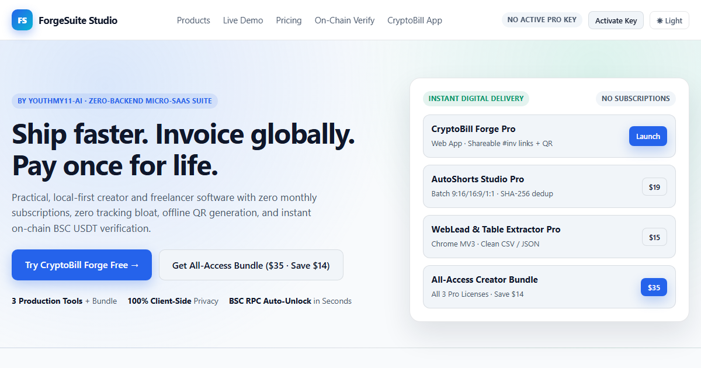

# ForgeSuite Studio (`youthmy11-ai.github.io`)

Zero-backend, privacy-first static GitHub Pages storefront & Micro-SaaS developer toolkit by **youthmy11-ai**.

Live Site: **`https://youthmy11-ai.github.io/`**




## Live Web Tools (`6 Free` Client-Side Utilities)

All web tools execute **100% inside local browser memory** with zero server uploads or telemetry:

1. **[CryptoBill Forge](https://youthmy11-ai.github.io/cryptobill.html)** (`cryptobill.html`) — **Free & Pro ($15 Lifetime)**
   - Serverless freelance crypto & PayPal invoice builder with A4 print-to-PDF layout (`@media print`).
   - Deterministic offline ISO/IEC 18004 QR Code Version 1–10 SVG/Canvas generator (`assets/qr.js`, zero third-party QR APIs).
   - Zero-backend shareable payment links via URL fragment (`#inv=<base64url>`).
2. **[TokenCost Lab](https://youthmy11-ai.github.io/tokencalc.html)** (`tokencalc.html`) — **Free**
   - Multi-turn AI agent & LLM token cost, prompt-cache savings, and SaaS API pricing estimator with 1-click export to CryptoBill invoices.
3. **[JSON2Sheet & PII Masker](https://youthmy11-ai.github.io/json2sheet.html)** (`json2sheet.html`) — **Free**
   - Flattens nested JSON arrays cleanly into RFC-4180 CSV spreadsheets while masking sensitive emails, phones, and wallet strings locally.
4. **[ScopeGuard SOW Builder](https://youthmy11-ai.github.io/sowbuilder.html)** (`sowbuilder.html`) — **Free**
   - Interactive Statement of Work & milestone payment split generator with instant 1-click handoff into CryptoBill Forge (`#inv=`).
5. **[Calldata Lens](https://youthmy11-ai.github.io/txdecode.html)** (`txdecode.html`) — **Free**
   - Offline Ethereum & BSC EVM hex calldata decoder (`ERC-20`, `MAX_UINT256` infinite approval risk warnings, `EIP-2612` permits, `ERC-4626`, `Safe` multisig) with zero RPC logging.
6. **[EnvShield Secret Scanner](https://youthmy11-ai.github.io/envshield.html)** (`envshield.html`) — **Free**
   - Instant client-side `.env`, JSON, and transcript secret scanner & safe redactor covering OpenAI, Anthropic, GitHub, AWS, Google, Telegram, EVM private keys, JWTs, DB URIs, and high-entropy credentials.

## Packaged Pro Editions & Bundle (`3 Pro Tools · Save $14`)

- **CryptoBill Forge Pro** — `$15` Lifetime (Unlimited line items, white-label PDF, custom branding, batch presets)
- **[AutoShorts Studio Pro](https://github.com/youthmy11-ai/autoshorts-studio)** — `$19` Lifetime (Python + FFmpeg 9:16/16:9/1:1 batch shorts builder with SHA-256 deduplication; Free Community Edition on GitHub)
- **[WebLead & Table Extractor Pro](https://github.com/youthmy11-ai/weblead-extractor)** — `$15` Lifetime (Chrome MV3 DOM table, email & list scraper; Free Lite Edition on GitHub)
- **All-Access Creator & Freelancer Bundle** — **`$35` Lifetime** (Unlocks all 3 Pro products; Save `$14`)

## Verification & Zero-Backend Checkout (`assets/checkout.js`)

- **Instant On-Chain BSC USDT (BEP20):** Queries public BNB Smart Chain JSON-RPC (`eth_getTransactionReceipt`), validates official BSC USDT `Transfer` logs, and deterministically generates checksummed `FS-PRO-...` license keys in browser.
- **Alternative Payment Channels:** USDT (TRC20), Binance Pay, and direct PayPal checkout helpers.

## Running Automated Tests

Requires Node.js v20+ (`0` external npm dependencies):

```bash
node --test tests/suite.test.mjs
```

## Local Static Preview

```bash
npx serve .
```

## Support & License

- Support Email: `youthmy11@gmail.com`
- License: MIT (`LICENSE`)
