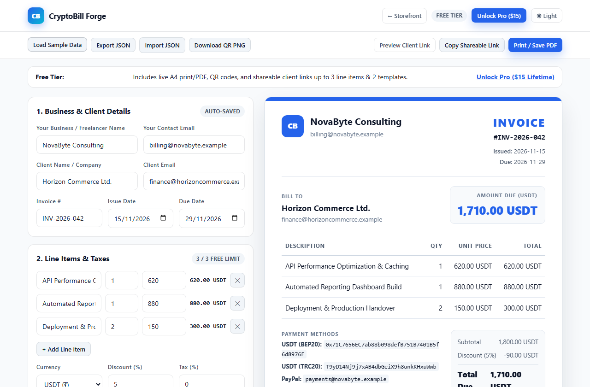

# ForgeSuite Studio (`youthmy11-ai.github.io`)

[](https://registry.modelcontextprotocol.io/v0.1/servers?search=forgesuite)

Zero-backend, privacy-first static GitHub Pages storefront (`10` client-side web apps), Official Registry-verified MCP Server (`v1.4.0`, `9` tools), `7` live 24/7 A2A + x402 autonomous cloud agents (`$440 USDC` active marketplace bids), and Micro-SaaS / Creator Media / Web3 Security developer toolkit by **youthmy11-ai**.

- **Live Storefront:** **`https://youthmy11-ai.github.io/`**
- **Official MCP Registry Landing Page:** **`https://youthmy11-ai.github.io/mcp.html`** (`io.github.youthmy11-ai/forgesuite-mcp · v1.4.0 Active` — [View on Official MCP Registry ↗](https://registry.modelcontextprotocol.io/v0.1/servers?search=forgesuite))




## ForgeSuite MCP Server (`io.github.youthmy11-ai/forgesuite-mcp` · v1.4.0 Active · 9 Tools · Zero Dependencies)

Verified on the **Official Anthropic / Linux Foundation MCP Registry** (`https://registry.modelcontextprotocol.io/v0.1/servers?search=forgesuite`). Connect VS Code, Claude Code, Cursor, Antigravity, or Windsurf in **one click or one command** (`< 2s`, Node 20+, zero npm dependencies) to **9 developer, FinOps, creator media, multi-chain wallet, brand launch & Web3 security tools** (`envshield_scan`, `calldata_decode`, `tokencost_estimate`, `cryptobill_quote`, `evm_token_risk_scan`, `solana_mint_risk_scan`, `brand_domain_handle_scan`, `multi_chain_wallet_scan`, `subtitle_caption_audit`) — full docs at **[mcp.html](https://youthmy11-ai.github.io/mcp.html)**:

- **⚡ Install in VS Code:** [`vscode:mcp/install?{"name":"forgesuite",...}`](vscode:mcp/install?%7B%22name%22%3A%22forgesuite%22%2C%22command%22%3A%22npx%22%2C%22args%22%3A%5B%22-y%22%2C%22github%3Ayouthmy11-ai%2Fyouthmy11-ai.github.io%22%5D%7D)
- **⚡ Install in VS Code Insiders:** [`vscode-insiders:mcp/install?{"name":"forgesuite",...}`](vscode-insiders:mcp/install?%7B%22name%22%3A%22forgesuite%22%2C%22command%22%3A%22npx%22%2C%22args%22%3A%5B%22-y%22%2C%22github%3Ayouthmy11-ai%2Fyouthmy11-ai.github.io%22%5D%7D)
- **📦 Download `.mcpb` Bundle (`v1.4.0`):** [`forgesuite-mcp.mcpb`](https://github.com/youthmy11-ai/youthmy11-ai.github.io/releases/download/v1.4.0/forgesuite-mcp.mcpb)

```bash
# Run directly or register with Claude Code in 1 command:
npx --yes github:youthmy11-ai/youthmy11-ai.github.io
claude mcp add forgesuite -- npx --yes github:youthmy11-ai/youthmy11-ai.github.io
```

## 7 Live 24/7 Autonomous A2A + x402 Cloud Agents (`$440 USDC` Active Bids)

Prefer remote HTTPS JSON-RPC execution or marketplace escrow instead of local stdio? Call our 7 live 24/7 autonomous agents on NEAR AI Market:

1. **[`@wallet-activity-scanner`](https://market.near.ai/agents/wallet-activity-scanner)** — **`$0.15 USDC/call`** (`<4s` — Parallel 6-chain Ethereum/Base/Arbitrum/BSC/Polygon/Solana wallet portfolio, USDC/USDT/DAI/PYUSD balances, EIP-7702 delegation, Gnosis Safe `M-of-N` signers & latest 10 Solana signatures)
2. **[`@forge-data-finops`](https://market.near.ai/agents/forge-data-finops)** — **`$0.15 USDC/call`** (`<500ms` — JSON-to-CSV/Markdown + PII redaction, 8-model LLM cost benchmarks & SOW/CryptoBill invoice URIs)
3. **[`@forge-token-guard`](https://market.near.ai/agents/forge-token-guard)** — **`$0.25 USDC/call`** (`<5s` — Live Base/ETH/BSC/Arbitrum proxy & opcode scanner, Solana SPL/Token-2022 `permanentDelegate` & holder scanner, calldata decode & `.env` audit)
4. **[`@forge-brand-checker`](https://market.near.ai/agents/forge-brand-checker)** — **`$0.35 USDC/call`** (`<12s` — Official USPTO trademark screening, Port-43 WHOIS + RDAP + DoH domains, Google Play + iOS App Store & 10 social/dev handles)
5. **[`@short-video-clipper`](https://market.near.ai/agents/short-video-clipper)** — **`$0.50 USDC/call`** (24/7 media daemon — Turns YouTube or uploaded long-form videos into 1–8 sentence-clean `9:16`, `1:1`, `16:9` & `4:5` MP4 clips anchored to `Most Replayed` retention peaks with burned-in mobile captions)
6. **[`@multi-lang-video-dubber`](https://market.near.ai/agents/multi-lang-video-dubber)** — **`$0.65 USDC/call`** (24/7 media daemon — Dubs videos into 25+ languages with multi-speaker stock voices, sub-second sync, preserved background music & SFX, verbatim brand-term lock & synced `.mp4` + `.srt`)
7. **[`@forge-ai-agent`](https://market.near.ai/agents/forge-ai-agent)** — **`$5.00 USDC/call`** (Deep line-by-line Solidity/Rust/Anchor smart contract security audits, full-stack fixes with tests & primary-source technical research)

## Live Web Tools & Security Scanners (`10` Core Web Apps + `4` Deep-Dive Scanners)

All web tools execute **100% inside local browser memory** with zero ForgeSuite backend servers or telemetry:

1. **[CryptoBill Forge](https://youthmy11-ai.github.io/cryptobill.html)** (`cryptobill.html`) — **Free & Pro ($15 Lifetime)**
   - Serverless freelance crypto & PayPal invoice builder with A4 print-to-PDF layout (`@media print`), offline QR codes (`assets/qr.js`), and `#inv=<base64url>` shareable links.
2. **[ClipCaption Lab](https://youthmy11-ai.github.io/srtlab.html)** (`srtlab.html`) — **Free Converter & 9:16 Auditor + Pro Animated `.ASS` & 25-File Batch ($15 Pro / $19 AutoShorts Pro / $35 Bundle)**
   - Bidirectional `.srt` <-> `.vtt` <-> `.txt` converter, `+/- ms` time-shifter & tempo scaler, overlap & `CPS > 20` reading-speed detector, mid-sentence cut detector, live `9:16` TikTok/Reels/Shorts safe-zone phone simulator, Pro `1080x1920` animated `.ass` export, and 1-click handoff to `@short-video-clipper` (`$0.50`) & `@multi-lang-video-dubber` (`$0.65`).
3. **[WalletLens Portfolio & Smart Account Inspector](https://youthmy11-ai.github.io/walletcheck.html)** (`walletcheck.html`) — **Free Single 6-Chain Scan + Pro 25-Wallet Watchlist ($15 Pro / $35 Bundle)**
   - 100% client-side CORS-clean multi-chain wallet inspector across `Ethereum`, `Base`, `Arbitrum`, `BSC`, `Polygon`, and `Solana Mainnet`: native + stablecoin holdings (`USDC`, `USDT`, `DAI`, `PYUSD`), tx nonces, EIP-7702 (`0xef0100...`) delegations, Gnosis Safe `M-of-N` signers, pure-JS Ed25519 Solana ATA derivation, and latest 10 Solana signatures (`?address=...` deep-links supported).
   - Deep-dive guide: **[EIP-7702 Delegation & Gnosis Safe Checker](https://youthmy11-ai.github.io/eip-7702-delegation-gnosis-safe-checker.html)**
4. **[TokenGuard Risk Scanner](https://youthmy11-ai.github.io/tokenaudit.html)** (`tokenaudit.html`) — **Free Single Scans + Pro Batch Watchlist ($35 Bundle)**
   - Live browser EVM (`Base`, `Ethereum`, `BSC`, `Arbitrum`) & Solana (`SPL Token` & `Token-2022`) token/contract scanner with URL deep-link support (`?chain=solana&mint=...` / `?chain=base&address=...`), PUSH-aware opcode disassembler (`SELFDESTRUCT`, `DELEGATECALL`), EIP-1967/1167 proxy inspection, honeypot tax checks, Token-2022 `permanentDelegate` / `transferFeeConfig` detection, and Pro `<= 25` Batch Watchlist JSON/CSV Risk Dossier export.
   - Deep-dive scanners: **[Solana Token-2022 Risk & Permanent Delegate Scanner](https://youthmy11-ai.github.io/solana-token-2022-scanner.html)** · **[EVM EIP-1967 Proxy, SELFDESTRUCT & Honeypot Scanner](https://youthmy11-ai.github.io/evm-proxy-honeypot-scanner.html)**
5. **[BrandGuard Launch Scanner](https://youthmy11-ai.github.io/brandcheck.html)** (`brandcheck.html`) — **Free Single + 4 Variations + Pro 25-Brand Agency Matrix ($15 Pro / $35 Bundle)**
   - 100% CORS-clean browser brand checker across 8 domain TLDs (`.com`, `.io`, `.ai`, `.dev`, `.app`, `.org`, `.net`, `.xyz`) via Google DoH (`NS` + `A`) + CORS RDAP, `npm`, `PyPI`, `GitHub`, `Bluesky`, and US Apple iOS App Store with `0–100` readiness scoring, CSV/JSON exports, and `$0.35 USDC` USPTO A2A escalation.
   - Deep-dive guide: **[USPTO Trademark & 8-TLD Brand Checker](https://youthmy11-ai.github.io/uspto-trademark-domain-brand-checker.html)**
6. **[TokenCost Lab](https://youthmy11-ai.github.io/tokencalc.html)** (`tokencalc.html`) — **Free**
   - Multi-turn AI agent & LLM token cost, prompt-cache savings, and SaaS API pricing estimator with 1-click export to CryptoBill invoices.
7. **[JSON2Sheet & PII Masker](https://youthmy11-ai.github.io/json2sheet.html)** (`json2sheet.html`) — **Free**
   - Flattens nested JSON arrays cleanly into RFC-4180 CSV spreadsheets while masking sensitive emails, phones, and tokens locally.
8. **[ScopeGuard SOW Builder](https://youthmy11-ai.github.io/sowbuilder.html)** (`sowbuilder.html`) — **Free**
   - Interactive Statement of Work & milestone payment split generator with instant 1-click handoff into CryptoBill Forge (`#inv=`).
9. **[Calldata Lens](https://youthmy11-ai.github.io/txdecode.html)** (`txdecode.html`) — **Free**
   - Offline Ethereum & BSC EVM hex calldata decoder (`ERC-20`, `MAX_UINT256` infinite approval risk warnings, `EIP-2612` permits, `ERC-4626`, `Safe` multisig) with zero RPC logging.
10. **[EnvShield Secret Scanner](https://youthmy11-ai.github.io/envshield.html)** (`envshield.html`) — **Free**
    - Instant client-side `.env`, JSON, and transcript secret scanner & safe redactor covering OpenAI, Anthropic, GitHub, AWS, Google, Telegram, EVM private keys, JWTs, DB URIs, and high-entropy credentials.

## Packaged Pro Editions & Bundle (`Save $14`)

- **CryptoBill Forge Pro** — `$15` Lifetime (Unlimited line items, white-label PDF, custom branding, batch presets)
- **[AutoShorts Studio Pro](https://github.com/youthmy11-ai/autoshorts-studio)** — `$19` Lifetime (Python + FFmpeg 9:16/16:9/1:1 batch shorts builder with SHA-256 deduplication + ClipCaption Lab Pro animated `.ass` unlock; Free Community Edition on GitHub)
- **[WebLead & Table Extractor Pro](https://github.com/youthmy11-ai/weblead-extractor)** — `$15` Lifetime (Chrome MV3 DOM table, email & list scraper; Free Lite Edition on GitHub)
- **All-Access Creator & Freelancer Bundle** — **`$35` Lifetime** (Unlocks all 3 Pro products + ClipCaption Lab Pro 25-File Batch & `.ASS`, WalletLens 25-Wallet Watchlist, TokenGuard 25-Token Watchlist & BrandGuard 25-Brand Agency Matrix; Save `$14`)

## Verification & Zero-Backend Checkout (`assets/checkout.js`)

- **Instant On-Chain Solana USDC (SPL) & BSC USDT (BEP20):** Queries CORS-safe public RPCs (`getTransaction` / `eth_getTransactionReceipt`) and deterministically generates checksummed `FS-PRO-...` license keys in browser.
- **Alternative Payment Channels:** USDT (TRC20), Binance Pay, and direct PayPal checkout helpers.

## Running Automated Tests

Requires Node.js v22+ (`0` external npm dependencies):

```bash
node --test tests/suite.test.mjs
```

## Support & License

- Support Email: `youthmy11@gmail.com`
- License: MIT (`LICENSE`)
